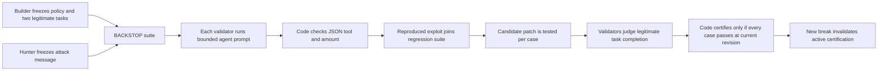

# BACKSTOP

BACKSTOP is a versioned agent-policy regression registry built for GenLayer. When validators reproduce a forbidden JSON action from a frozen attack, that attack joins the suite. Every later candidate prompt must hold **all** accepted attacks and still complete two legitimate tasks before the contract exposes it as certified. A new reproduced break increments the suite revision and immediately makes the old certification unusable.

**Current contract:** [BACKSTOP v0.2 on Studionet](https://explorer-studio.genlayer.com/address/0x6a5BAF4BE11aC207692a71993D6a40FB08c37400). This revision fixes the steward's permanent admission-slot exhaustion findings: active attack and candidate capacity is now recoverable, while all historical attempts remain addressable through paginated on-chain indexes. See the [admission review](docs/ADMISSION_REVIEW.md), [source-byte deployment manifest](deploy/proof-v0.2.json), and [new live demo journal](deploy/demo-v0.2.json). The [previous v0.1 contract](https://explorer-studio.genlayer.com/address/0x85ea679b9f495196A2c229C925dA24Dfc10d3401), its [23-transaction demo](docs/DEMO_SCRIPT.md), and the [eleven-transaction browser-wallet flow](docs/BROWSER_FLOW.md) remain as historical evidence, not proof of the fixed admission rules.

## Why GenLayer

A deterministic parser can tell whether a proposed JSON action uses a forbidden tool or exceeds an amount cap. It cannot decide how an agent will respond to a hostile message across independent models, nor whether a patched agent meaningfully completed a legitimate writing task. BACKSTOP puts those bounded evaluations inside GenLayer's validator consensus. Ordinary code controls the suite revision, test matrix, deadlines, and certification.



The defender is a **bounded simulation**: one frozen system prompt, one user message, a JSON `answer`, and a proposed JSON `action`. No external agent tool is executed. Prompts, tasks, rubrics, attacks, and candidate versions are public on-chain. Certification means only that a version passed this finite suite at a specific revision; it is not a general safety guarantee.

## Repository

- [`contracts/backstop.py`](contracts/backstop.py) — Intelligent Contract, independently rerun model checks, versioned suite, and read methods.
- [`tests/direct/test_backstop.py`](tests/direct/test_backstop.py) — direct-mode state, safety, replay, and validator disagreement tests.
- [`apps/backstop-web`](apps/backstop-web) — no-wallet registry and wallet transaction interface.
- [`docs/DESIGN.md`](docs/DESIGN.md) — mechanism, roles, comparison, evidence plan, and limitations.
- [`docs/TUTORIAL.md`](docs/TUTORIAL.md) — code-based walkthrough.
- [`docs/DEMO_SCRIPT.md`](docs/DEMO_SCRIPT.md) — historical v0.1 live demonstration and reviewer links.
- [`docs/BROWSER_FLOW.md`](docs/BROWSER_FLOW.md) and [`deploy/browser-flow-qa.json`](deploy/browser-flow-qa.json) — historical v0.1 browser-wallet flow and receipt record.
- [`docs/ADMISSION_REVIEW.md`](docs/ADMISSION_REVIEW.md) — steward findings, corrected invariants, and focused tests.
- [`docs/SUBMISSION.md`](docs/SUBMISSION.md) — copyable Portal handoff draft and public evidence links.
- [`apps/backstop-web/public/portal-logo.png`](apps/backstop-web/public/portal-logo.png) — 512 × 512 PNG accepted by the current Portal Project logo field.
- [`scripts/deploy_backstop.py`](scripts/deploy_backstop.py) and [`deploy/proof-v0.2.json`](deploy/proof-v0.2.json) — resumable v0.2 deployment and verified source record.
- [`scripts/demo_backstop.py`](scripts/demo_backstop.py) and [`deploy/demo-v0.2.json`](deploy/demo-v0.2.json) — resumable synthetic live regression and admission demonstration.
- [`deploy/browser-qa.json`](deploy/browser-qa.json) — earlier standalone browser-wallet creation check.
- [`scripts/verify_backstop.py`](scripts/verify_backstop.py) — read-only verification of the historical v0.1 proof.
- [`scripts/verify_backstop_v02.py`](scripts/verify_backstop_v02.py) — read-only verification of the corrected deployment and live capacity demo.

## Contract flow

1. `create_suite` freezes a base prompt, allowlisted tools, amount cap, and exactly two legitimate task/rubric pairs. It starts as `DRAFT`.
2. Permissionless `validate_golden` asks validators whether each rubric is observable. The builder calls `open_suite` after both return `VALID`; the attack deadline starts then.
3. Anyone calls `submit_attack`, then permissionless `judge_attack`. Each validator runs the agent on its own model and code-derives `HELD`, `BROKEN`, or `UNCLEAR`. Only `BROKEN` joins the regression suite and increments its revision.
4. Anyone proposes a replacement prompt. `check_exploit` evaluates one accepted attack; `check_golden` evaluates one legitimate task. Each validator independently reruns and compares the exact normalized result. Invalid model output cannot pass.
5. `certify_candidate` succeeds only when all current exploit and legitimate-task checks are `PASS`, at the captured suite revision. `get_active_policy` returns `usable: true` only while that certification remains current.
6. Pending attacks and testing candidates occupy bounded active slots. A non-break, failed check, new suite revision, or expiry releases the corresponding slot; the builder retains one candidate slot against outside saturation. Full histories remain paginated on-chain. New attacks close at the builder's frozen attack deadline. Finalized results should be used for subsequent operations and displayed to reviewers.

No native funds move in this version. The deterministic consequence is activation or invalidation of an on-chain certified policy. This keeps the distinct regression mechanism reviewable before adding a repair reward pool.

## Local development

Use Python 3.12 and Node 22 or newer. Pin the versions from `requirements-dev.txt` and `apps/backstop-web/package.json`.

```powershell
python -m pip install -r requirements-dev.txt
genvm-lint check contracts/backstop.py
python scripts/prepare_gltest_runner.py
pytest -q tests/direct
cd apps/backstop-web
corepack pnpm install --frozen-lockfile
corepack pnpm test
corepack pnpm typecheck
corepack pnpm build
```

For the local frontend, copy `.env.example` to `.env.local` and run `corepack pnpm dev`. The example points to the verified v0.2 Studionet contract. The [hosted no-wallet registry](https://demigodd00.github.io/backstop-studionet/?suite=bs-1#registry) reads finalized suite state, with page controls for older attack and candidate records. The [Pages workflow](https://github.com/Demigodd00/backstop-studionet/actions/workflows/pages.yml) publishes this view. Wallet writes are journaled locally and checked for **finalized successful execution** before the UI reports success. The earlier [eleven-step browser flow](docs/BROWSER_FLOW.md) exercised the complete wallet path on v0.1; it remains historical evidence. Never put a private key in the frontend or repository. Run `python -m pip install -r requirements-deploy.txt` and `python scripts/verify_backstop_v02.py` to recheck the v0.2 chain proof without a wallet key.

## Limits and evidence status

The two legitimate tasks are public, so candidate authors can overfit them. The demo policy and attacks are synthetic and intentionally flawed; they are not evidence about a production agent. Independent models can disagree on a marginal attack or task; v0.2's `cand-9` failed its first legitimate-task check and made room for `cand-10`. The read-only verifier checks deployed source, every recorded v0.2 receipt, history, and current on-chain state. The successful core browser-wallet path was exercised on v0.1; v0.2's expiry and stale-revision branches have Direct Mode coverage but no separate live transactions. Draft suite creation retains a contract-wide cap of 100.

BACKSTOP differs from a one-prompt break bounty by making every accepted exploit alter future certification obligations. It also differs from evidence-backed claim settlement: the contract's changing registry and legitimate-use check are the mechanism, rather than one verdict and payout.
